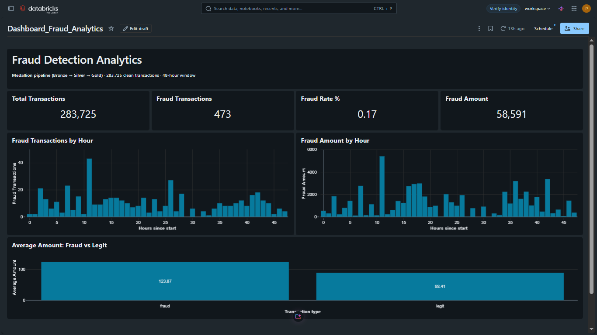
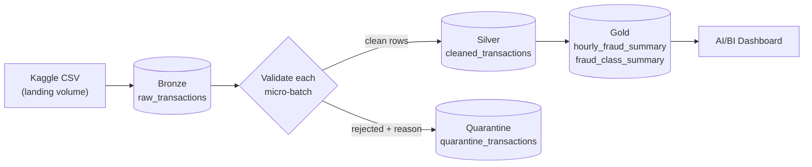

# Realtime Fraud Detection Pipeline

A small end-to-end data engineering project I built on Databricks. It takes raw credit card transactions, cleans them in a streaming job, and ends with a dashboard that shows when fraud happens and how big it is.

I built it to get hands-on with the Bronze / Silver / Gold pattern, Structured Streaming and Delta Lake, and to see what happens to messy data when you actually run it through a pipeline instead of just reading about it.

## Architecture

## What it does

Raw files land in a Unity Catalog volume. From there the data moves through three layers:

- **Bronze** holds the raw transactions exactly as they arrived.
- **Silver** holds the validated rows. Anything that fails a check goes to a separate quarantine table instead of being dropped.
- **Gold** holds two small summary tables built for the dashboard: fraud by hour, and fraud versus legit transactions.

## The data

I used the Kaggle credit card fraud dataset: 284,807 transactions with `Time`, `Amount`, `Class` and 28 anonymised features (V1 to V28). `Class` is 1 for fraud and 0 for legit. The CSV is not in this repo because of its size. You can get it here: https://www.kaggle.com/datasets/mlg-ulb/creditcardfraud

One thing worth knowing: `Time` is the number of seconds since the first transaction, not a real timestamp. So "hour 11" in the dashboard means the 11th hour of the dataset, not 11 AM.

## What came out of it

| Layer | Rows |
|---|---|
| Bronze (raw) | 284,807 |
| Silver (clean) | 283,725 |
| Quarantine | 1,082 |

The quarantine table is the part I like most. Of those 1,082 rows, 1,081 were exact duplicates and 1 was a record with a null `Time`. My first version of the Silver logic would have dropped all of them silently and I would never have known. Keeping them in quarantine with a reason attached means every row is accounted for: 283,725 + 1,082 = 284,807.

On the clean data, there are 473 fraud transactions out of 283,725 (about 0.17%), worth 58,591 in total. Fraud transactions average 123.87, against 88.41 for legit ones.

## How the Silver step works

The Silver notebook reads Bronze as a stream and processes each micro-batch with `foreachBatch`. Every row gets a reason tag in a single pass:

- `null_required_field` if `Time`, `Amount` or `Class` is null
- `invalid_amount` if the amount is negative or NaN
- `invalid_class` if `Class` is not 0 or 1
- `duplicate` if the row is a repeat within the same batch (the first copy is kept)

Rows with no tag go to `cleaned_transactions`. Everything else goes to `quarantine_transactions` along with the reason, the batch ID and a timestamp.

There is also a simple circuit breaker. If more than 10% of a batch gets rejected, the job stops before writing anything. I used a ratio instead of a fixed row count because a fixed number kept tripping on the first full load.

Writes use Delta's `txnAppId` and `txnVersion`, so retrying a failed batch won't insert the same rows twice.

## Running it

You need a Databricks workspace with Unity Catalog. I built this on the free edition with serverless compute.

1. Upload the Kaggle CSV to the landing volume.
2. Run the notebooks in this order:
   1. `setup_environment` creates the catalog, schemas and volumes
   2. `Ingest_Transaction_Stream` loads the raw data into Bronze
   3. `Ingest_Transaction_Silver` validates and splits the data into Silver and quarantine
   4. `Data_Quality_Checks` audits the result
   5. `Fraud_Analytics_Gold` builds the two summary tables
3. Import `Dashboard_Fraud_Analytics.lvdash.json` into Databricks to get the dashboard back, or just rebuild it from the Gold tables.

Table names live in `variables`.

The quality check notebook is worth running every time. It confirms Bronze equals Silver plus quarantine, and it fails loudly if Silver contains nulls, bad values or duplicates.

## Things to watch out for

- **Resetting the checkpoint.** Batch IDs restart from zero after a reset, and the idempotent writes will then skip data they think they already wrote. If you reset a checkpoint, change the `txnAppId` values too.
- **Schema names.** My schemas used to start with numbers (`01_bronze` and so on). They needed backticks everywhere and caused a few annoying errors, so I renamed them to plain `bronze`, `silver` and `gold`.

## Limitations

I would rather be upfront about these than have someone find them later.

- The name says "realtime", but the job runs with `trigger(availableNow=True)`. It processes everything new since the last run and then stops, so it's incremental batch, not continuous streaming. Making it truly real-time would mean a generator dropping new files into the landing volume and a continuously running stream.
- Deduplication only works inside a single micro-batch. If the same transaction shows up in two different batches, it won't be caught. A `MERGE` into Silver would fix that.
- Duplicates are matched on all columns. Since the dataset has no transaction ID, two genuinely different transactions that are identical in every field would be treated as duplicates. That's unlikely with 30 features, but it's still an assumption.
- It's one dataset of about 284k rows on a free workspace. It shows the design, not production scale.

## Ideas for next time

- Train a simple fraud classifier on the Silver table and track it with MLflow. With fraud at 0.17%, precision and recall matter far more than accuracy.
- Run the notebooks as a Databricks Job, with the quality check as a gate before Gold.
- Add a file generator so the pipeline actually receives new data over time.

## Tech used

Databricks, PySpark, Structured Streaming, Delta Lake, Unity Catalog, Databricks AI/BI dashboards.
